# OUTPOST-X

<div align="center">


### Take Command. Build Beyond Earth. Shape Humanity’s Next Frontier.

**An Authentic Deep-Space Planetary Habitat Simulator & Junior Astronaut Mission Trainer**  
*Developed for the **2026 NASA Space Apps Challenge** by Team **TensorMinds***

[](https://outpostx.vercel.app/)
[](https://drive.google.com/drive/folders/1wsaJml4QNPZhfF7jVdb0f7KvSvgHjKfd)
[](package.json)
[](packages/sim/src/validation/)
[](apps/web/vite.config.ts)
[](docs/CREDITS.md)

---

### 🌐 Quick Links & Access Portals

| Portal | Destination | Description |
|---|---|---|
| 🚀 **Live Deployed Application** | **[https://outpostx.vercel.app/](https://outpostx.vercel.app/)** | Play instantly in any modern desktop or mobile browser. No installation or account required. |
| 📁 **NASA Space Apps Submission Drive** | **[Google Drive Folder](https://drive.google.com/drive/folders/1wsaJml4QNPZhfF7jVdb0f7KvSvgHjKfd)** | Project presentation deck, high-resolution gameplay videos, and scientific documentation. |
| 📖 **Static Scientific Briefing & About** | **[`about.html`](apps/web/public/about.html)** | Complete offline catalog of technical specifications, data citations, and mission rules. |

</div>

---

## Table of Contents

1. [Challenge Overview & Problem Statement](#1-challenge-overview--problem-statement)
2. [The Pedagogical Gap & Our Solution](#2-the-pedagogical-gap--our-solution)
3. [The Core Innovation: The Reality Dial](#3-the-core-innovation-the-reality-dial)
4. [System Architecture & Engineering Design](#4-system-architecture--engineering-design)
5. [Operational Console Tour & Visual Showcase](#5-operational-console-tour--visual-showcase)
6. [Training Scenarios & Historical Crisis Replays](#6-training-scenarios--historical-crisis-replays)
7. [Authenticated NASA Datasets, APIs & Science Pedigree](#7-authenticated-nasa-datasets-apis--science-pedigree)
8. [Engineering Rigor, Quality Assurance & Accuracy](#8-engineering-rigor-quality-assurance--accuracy)
9. [Technology Stack & Repository Structure](#9-technology-stack--repository-structure)
10. [Local Installation, Setup & Execution Guide](#10-local-installation-setup--execution-guide)
11. [Project Team: TensorMinds](#11-project-team-tensorminds)
12. [Terms & Conditions, Legal Disclaimers & Copyright](#12-terms--conditions-legal-disclaimers--copyright)

---

## 1. Challenge Overview & Problem Statement

### 2026 NASA Space Apps Challenge
* **Challenge:** *Build a Junior Astronaut Mission Trainer*
* **Difficulty:** Intermediate / Beginner / Youth
* **Subjects:** Games, Planets & Moons, Software, Space Exploration, Sun

```
               NASA SPACE APPS CHALLENGE 2026: PROBLEM STATEMENT
"Space-themed STEM content often oversimplifies the engineering trade-offs that 
define a real mission or presents them at a level too complex to hold a young learner's 
attention. Few tools make those trade-offs both tangible and fun. Your challenge is 
to design and build an interactive game or app that lets students run a lunar or 
Martian outpost, balancing competing demands like life support, radiation shielding, 
power, and food production, so they experience firsthand the decisions that determine 
whether a mission fails or succeeds."
```

### Challenge Objectives & Criteria

* **Target Audience:** Primary focus on youth ages 7–12, with cognitive scalability to challenge teenagers, university students, educators, and flight simulation enthusiasts.
* **Core Competencies:** Turning genuine deep-space survival constraints into intuitive game mechanics—reinforcing that **no choice is free** and that saving power today may cost oxygen tomorrow.
* **Real Science Foundation:** Grounding simulation mechanics in authentic, open NASA datasets rather than fabricated science fiction tropes:
  * **Space Weather Database (DONKI):** Solar flare telemetry, coronal mass ejections (CMEs), and solar proton storms.
  * **Open Science Data Repository (OSDR):** Astronaut health research, microgravity biology, and radiation dosimetry via RadLab.
  * **Planetary Surface Missions:** High-resolution digital elevation models, dust optical depth, and thermal extremes from Artemis lunar candidate regions and Mars Perseverance/Curiosity rover sites.
* **Accessibility:** Zero barrier to entry. Browser-playable, fully offline-functional progressive web application (PWA) with zero mandatory downloads, accounts, or proprietary hardware.

---

## 2. The Pedagogical Gap & Our Solution

Traditional space education for youth suffers from a severe **translation gap**:

```
 ┌──────────────────────────────────────┐     ┌──────────────────────────────────────┐
 │    Traditional Youth STEM Games      │     │  Academic Telemetry & Spreadsheets   │
 ├──────────────────────────────────────┤     ├──────────────────────────────────────┤
 │ • Cartoonish, "click-to-win" UI      │     │ • Dense, intimidating equations      │
 │ • Fabricated health/shield bars      │ VS  │ • Hostile command-line interfaces    │
 │ • Zero physical trade-off penalties  │     │ • Zero interactive visual engagement │
 │ • Fails to teach real engineering    │     │ • Loses young learner attention      │
 └──────────────────────────────────────┘     └──────────────────────────────────────┘
                                    ▼
       ┌──────────────────────────────────────────────────────────────┐
       │             THE OUTPOST-X SOLUTION: COGNITIVE BRIDGING        │
       ├──────────────────────────────────────────────────────────────┤
       │ 1. ONE pure deterministic physics engine (authentic NASA).   │
       │ 2. THREE age-adaptive presentation tiers (Reality Dial).     │
       │ 3. Competing resource mechanics (zero-sum trade-offs).       │
       │ 4. Accessible, photorealistic mission control atmosphere.    │
       └──────────────────────────────────────────────────────────────┘
```

### Our Core Solutions
1. **Zero-Sum Resource Dynamics:** Power, thermal rejection, atmospheric partial pressures, consumable mass, and crew hours exist in strict closed-loop thermodynamic balance. For example:
   * Running the **Brine Processor Assembly (BPA)** increases water recovery from $93\%$ to $98\%$, but consumes **1.5 crew-hours/day** of critical maintenance time and **$0.35\text{ kW}$** of continuous power.
   * Enriching greenhouse $CO_2$ to $1,200\text{ ppm}$ accelerates crop growth by $22\%$, but risks astronaut cognitive fatigue and acute respiratory acidosis.
   * Deploying full regolith radiation berms protects against ionizing solar particle events, but demands hundreds of hours of rover excavation and structural mass budget.
2. **Deterministic Scientific Fidelity:** Every physical constant—from the human oxygen consumption rate ($0.84\text{ kg/crew-day}$) to lunar surface radiation ($1.369\text{ mSv/day}$)—traces directly to authenticated NASA publications (BVAD-2022, OCHMO, ICES).
3. **Replayability & Formative Learning:** If a station fails, players utilize **Try Again / Rewind** to step back to the planning phase, inspect the causal incident graph, and understand exactly why their operational choices compromised habitat integrity.

---

## 3. The Core Innovation: The Reality Dial

The central breakthrough of OUTPOST-X is the **Reality Dial**: **One unified simulation engine presented across three distinct cognitive depths.** 

Toggling the Reality Dial mid-simulation transforms the user interface, labels, tooltips, and explanations without altering a single underlying physical value. The simulation state remains byte-for-byte identical.

```
                    ┌──────────────────────────────────────────────┐
                    │       DETERMINISTIC SIMULATION CORE          │
                    │   (Pure TypeScript • 100% NASA BVAD Physics)  │
                    └──────────────────────┬───────────────────────┘
                                           │
             ┌─────────────────────────────┼─────────────────────────────┐
             ▼                             ▼                             ▼
   ┌───────────────────┐         ┌───────────────────┐         ┌───────────────────┐
   │    CADET LEVEL    │         │ SPECIALIST LEVEL  │         │  COMMANDER LEVEL  │
   │    (Ages 7–12)    │         │   (Ages 12–14)    │         │    (Ages 15+)     │
   ├───────────────────┤         ├───────────────────┤         ├───────────────────┤
   │ Visual icons      │         │ Real SI units     │         │ Rate equations    │
   │ Plain-word status │         │ Explicit values   │         │ Derivatives       │
   │ Visual bars       │         │ Subsystem flow    │         │ Margin thresholds │
   │ Grade 3.6 reading │         │ Grade 7.2 reading │         │ Flight controller │
   └───────────────────┘         └───────────────────┘         └───────────────────┘
```

### Reality Dial Comparison Matrix

| Subsystem Dimension | Cadet View (Ages 7–12) | Specialist View (Ages 12–14) | Commander View (Ages 15+) | Underlying Physical Invariant |
|---|---|---|---|---|
| **Life Support Oxygen** | 🟢 **Air is Good** (Green bar) | **$21.3\text{ kPa}$** (Nominal $O_2$ partial pressure) | **$ppO_2 = 21.3\text{ kPa}$** ($\dot{m}_{O_2} = -0.84\text{ kg/CM-d}$) | NASA OCHMO TB-003 Habitable Atmosphere Standard |
| **Power Storage** | 🟡 **Half Full** (Yellow icon) | **$150.0\text{ kWh} / 300\text{ kWh}$** ($50\%$ SOC) | **$\frac{dE}{dt} = P_{in} - P_{out}$** ($SOC: 50.0\%$, $V_{bus}: 120\text{V}$) | NASA Fission Surface Power & Li-ion Deg. Model |
| **Ionizing Radiation** | 🔴 **High Storm Alert!** | **$4.8\text{ mSv/day}$** (Acute Storm Peak) | **$\dot{D} = 4.8\text{ mSv/d}$** ($D_{cum} \ge 250\text{ mSv}$ limit) | NASA HRP Acute Radiation Syndrome Limits |
| **Water Balance** | 💧 **Water Safe** | **$93\%$ Closed-Loop Recovery** | **$\eta_{rec} = 93.0\%$** ($\Delta V_{res} = -2.4\text{ L/sol}$) | NASA ICES-2017 Closed-Loop ECLSS Metrics |
| **Interplanetary Lag** | ⏳ **Signal Delayed** | **$14\text{ min } 22\text{ s}$ One-Way Delay** | **$\tau = \frac{R_{\oplus \to Mars}}{c} = 862\text{ s}$** | JPL Horizons Dynamic Ephemerides Telemetry |

---

## 4. System Architecture & Engineering Design

OUTPOST-X is architected as a high-performance monorepo utilizing strict modular boundaries. The core physics engine is decoupled from the DOM, guaranteeing determinism, testability, and cross-platform portability.

### High-Level System Architecture

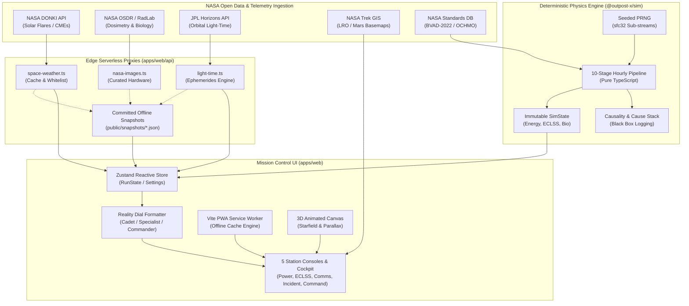

### The 10-Stage Hourly Simulation Pipeline

The simulation ticks on an exact one-hour cadence. Every tick executes an immutable, 10-stage mathematical pipeline in strict thermodynamic order:

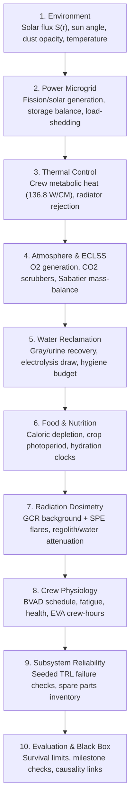

### Cause-and-Effect Ripple Causality Engine
Unlike typical games that log isolated text messages, OUTPOST-X maintains an internal **Directed Acyclic Graph (DAG)** of all mission events. When an environmental hazard occurs, subsequent subsystem degradations inherit parent causality pointers:

```
[Extreme Solar Flare (DONKI SEP)] 
       │
       ├──► [Radiation Alert: Evacuate to Regolith Berm]
       │           │
       │           └──► [EVA Science Aborted] ──► [Daily Research Target Missed]
       │
       └──► [Solar Array Dust Accumulation & Grid Drop]
                   │
                   └──► [Priority Load Shedding Activated]
                               │
                               └──► [Brine Processor Powered Down]
                                           │
                                           └──► [Water Reserves Depleted by 1.8 L]
```

---

## 5. Operational Console Tour & Visual Showcase

OUTPOST-X features five authentic operational consoles, a photorealistic planetary cockpit, interactive 3D orbital trajectory replays, and full-spectrum mission analytics.

---

### Main Command Deck & Mission Hero
The landing interface welcomes junior astronauts with live orbital markers, landing site telemetry, and mission launch parameters.

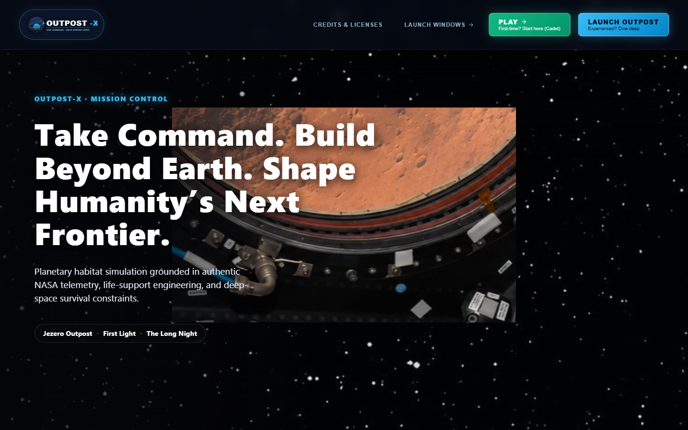
*Figure 5.1: The OUTPOST-X Mission Command Deck featuring the responsive branding, landing window indicators, and deep-space canvas.*

---

### Artemis II Trajectory Replay & Orion Flight Integration
Grounding the simulation in contemporary NASA lunar exploration, the main deck embeds real circumlunar flight telemetry from the upcoming Artemis II mission.

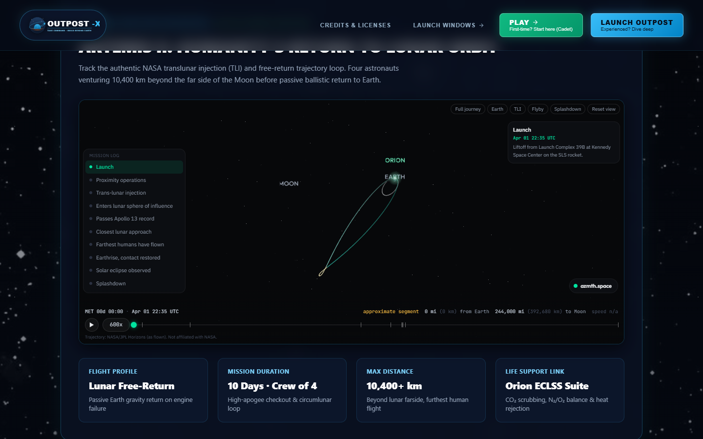
*Figure 5.2: Live Artemis II translunar injection (TLI) and free-return trajectory replay powered by Azimuth space telemetry.*

---

### Deep-Space Aerospace Architecture & Mission Pillars
Every operational module reflects authentic NASA space flight engineering: closed-loop life support, fission microgrids, space weather monitoring, and real light-time communications delays.

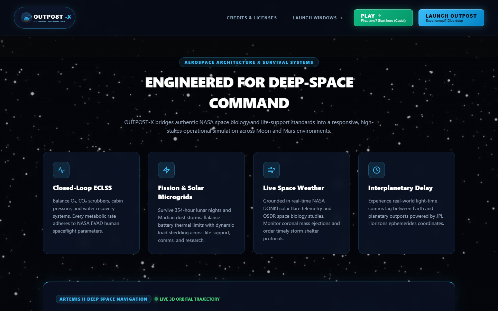
*Figure 5.3: Core engineering pillars anchoring the mathematical models of OUTPOST-X.*

---

### Mission Setup Wizard & Landing Site Exploration
Commanders select between lunar and Martian outpost sites, configuring crew size, power generation profiles, and radiation shielding architecture.

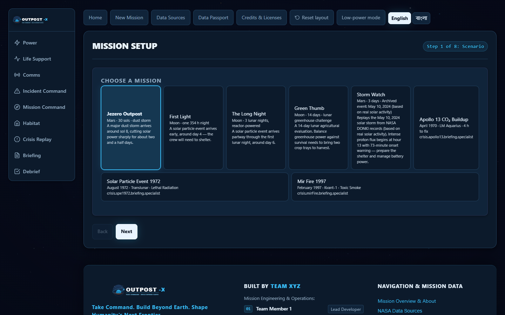
*Figure 5.4: Mission Setup Wizard allowing custom configuration of landing coordinates, power sources, and regolith shielding.*

---

### Fission & Solar Power Microgrid Console
Manage electrical distribution across life support, thermal loops, ISRU fuel plants, and agricultural modules. Reorder dynamic load-shedding priority lists before nightfall.

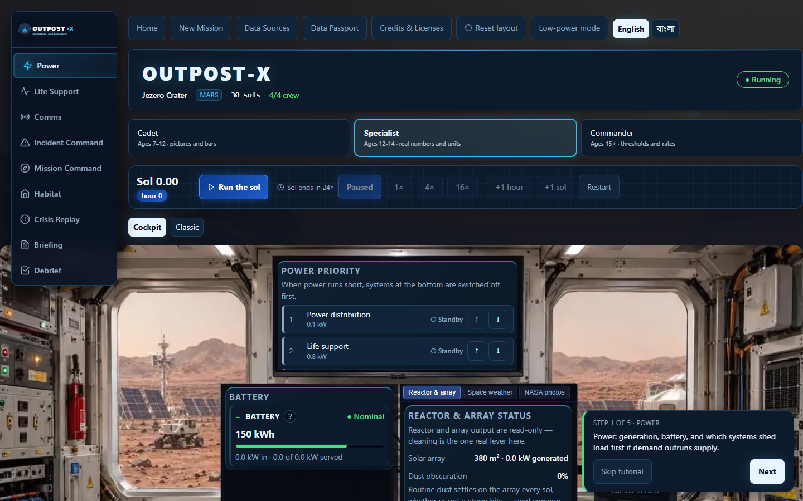
*Figure 5.5: Power Console displaying real-time kilowatt generation, battery state-of-charge, and automated load-shedding hierarchy.*

---

### Closed-Loop ECLSS Atmospheric & Water Console
Monitor cabin atmospheric partial pressures ($ppO_2$, $ppCO_2$, $ppN_2$), regulate Sabatier carbon dioxide reduction units, and balance multi-stage water recovery loops.

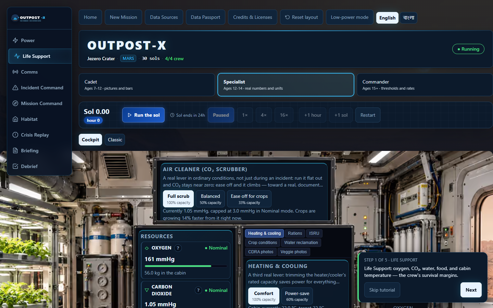
*Figure 5.6: Life Support Console with stoichiometric mass balances, consumable margins, and emergency scrubber controls.*

---

### Deep Space Network (DSN) & Comms Console
Experience true interplanetary communication latency calculated dynamically via JPL Horizons ephemerides. Plan transmissions around planetary occultations and orbital blackouts.

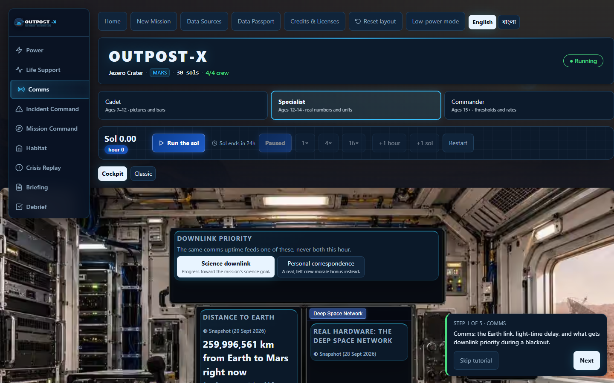
*Figure 5.7: Comms Console showing light-time latency, link margins, and Deep Space Network antenna schedules.*

---

### Space Weather (DONKI) & Incident Command
Receive live alerts for solar proton events, coronal mass ejections, and micrometeoroid impacts. Triage emergency damage and direct crew repair schedules.

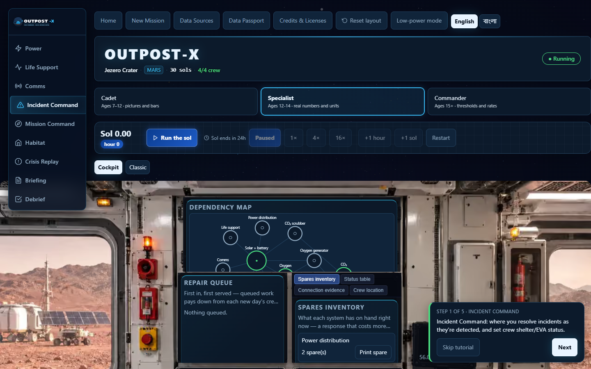
*Figure 5.8: Incident Command Console featuring real-time solar flare tracking from NASA DONKI and causal fault trees.*

---

### Crew Station Assignments & Mission Command
Deploy crew members across operational consoles according to NASA BVAD-2022 human spaceflight schedules. Balance productive work hours against physical fatigue and radiation exposure.

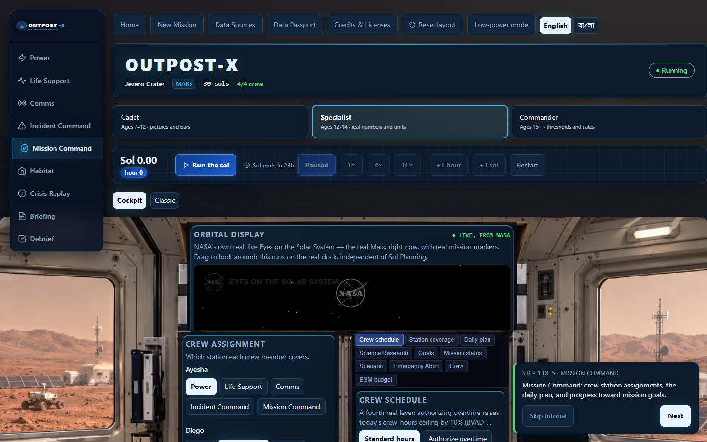
*Figure 5.9: Mission Command Console managing station assignments, daily plans, and real NASA orbital visualizers.*

---

### Habitat Cross-Section & Environmental Monitoring
Inspect the internal structure of the planetary outpost, monitoring pressurized volume integrity, radiation shelter shielding, and airlock cycles.

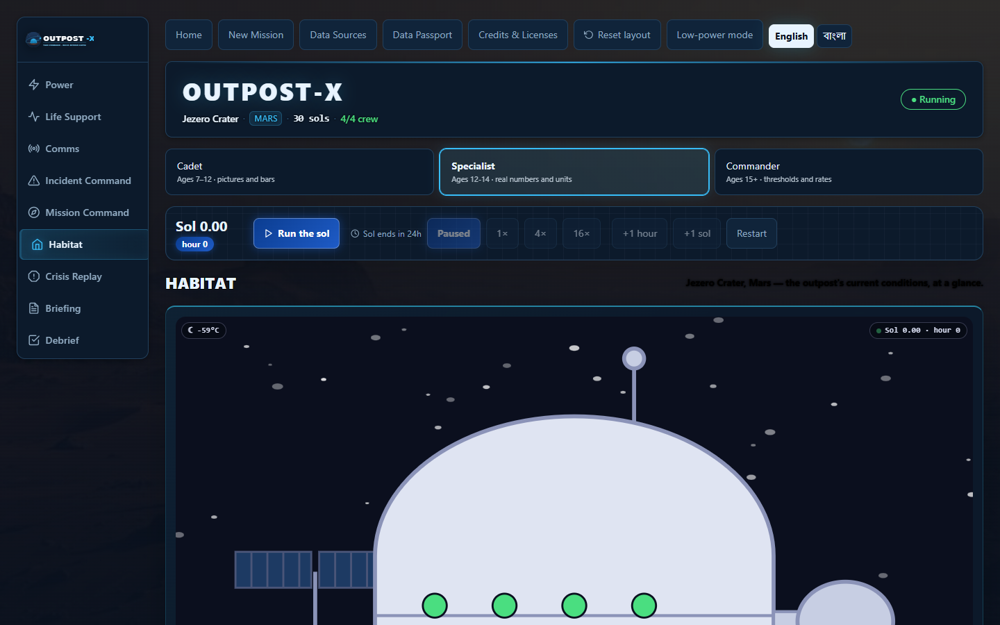
*Figure 5.10: Planetary Habitat cross-section showing module status, airlock cycles, and thermal envelopes.*

---

### Historical Crisis Replay Mode
Test your command capabilities in recreations of legendary spaceflight emergencies: Apollo 13 $CO_2$ scrubber adaptation, the August 1972 extreme solar storm, and the 1997 Mir space station fire.

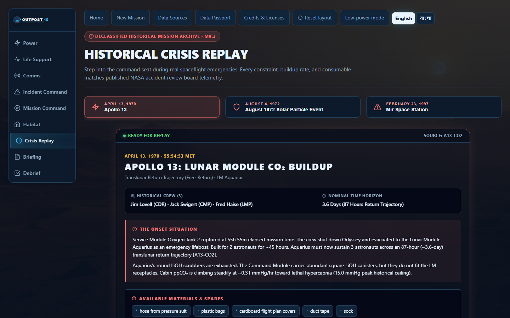
*Figure 5.11: Historical Crisis Replay interface utilizing authentic NASA mishap investigation board telemetry.*

---

## 6. Training Scenarios & Historical Crisis Replays

OUTPOST-X provides five progressive training scenarios and three historical crisis replays, offering over 20 hours of STEM gameplay.

### Standard Training Scenarios

| Scenario | Target Body | Surface Coordinates | Mission Length | Primary Engineering Hazard |
|---|---|---|---|---|
| **Jezero Outpost** | Mars | $18.38^\circ\text{N}, 77.58^\circ\text{E}$ (Perseverance site) | 30 Sols | Global dust storm ($tau = 2.5$) reducing solar power by $85\%$. |
| **First Light** | Moon | $89.45^\circ\text{S}, 222.8^\circ\text{E}$ (Connecting Ridge) | 31 Days | Continuous 354-hour cryogenic lunar polar night. |
| **The Long Night** | Moon | $89.45^\circ\text{S}, 222.8^\circ\text{E}$ (Artemis Basecamp) | 89 Days | Multi-cycle polar night with micro-fission reactor load balancing. |
| **Green Thumb** | Moon | $14.1^\circ\text{N}, 303.4^\circ\text{E}$ (Marius Hills Lava Tubes) | 14 Days | Closed-loop crop lighting schedule and elevated $CO_2$ biology. |
| **Storm Watch** | Mars | $18.38^\circ\text{N}, 77.58^\circ\text{E}$ (Jezero Crater) | 3 Sols | NASA DONKI-archived Extreme Solar Proton Event (SEP). |

### Historical Crisis Replays

| Historical Crisis | Spacecraft / Station | Historical Date | Mission-Critical Emergency Lever |
|---|---|---|---|
| **Apollo 13 $CO_2$ Crisis** | Apollo LM *Aquarius* | April 1970 | Improvised square-to-round lithium hydroxide ($LiOH$) scrubber cartridge fabrication. |
| **Solar Particle Event 1972** | Apollo Lunar Base (Descartes) | August 1972 | Evacuation of EVA crew to subsurface regolith shelter under lethal proton bombardment ($>400\text{ mSv}$). |
| **Mir Space Station Fire** | Mir *Kvant-1* Module | February 1997 | Solid-fuel oxygen generator (*Vika*) combustion, smoke isolation, and toxic scrubbing. |

---

## 7. Authenticated NASA Datasets, APIs & Science Pedigree

Every physical constant, boundary limit, and telemetry feed in OUTPOST-X is traced to official space agency literature. **Zero physical values are fabricated.**

### NASA APIs & Live Service Endpoints

| NASA Service | API Endpoint / Resource | In-Game Application | Agency Attribution |
|---|---|---|---|
| **Space Weather Database (DONKI)** | `https://api.nasa.gov/DONKI/` | Real-time solar flare, CME, and geomagnetic storm alerts. | NASA CCMC / Space Weather Research Center |
| **JPL Horizons Ephemerides** | `https://ssd.jpl.nasa.gov/api/horizons.api` | Precise speed-of-light comms latency between Earth and Mars/Moon. | NASA JPL Solar System Dynamics Group |
| **NASA Image & Video Library** | `https://images-api.nasa.gov/search` | Real photography of spaceflight hardware and flight systems. | NASA Headquarters / Public Photo Archive |
| **NASA Moon Trek GIS** | `https://trek.nasa.gov/tiles/Moon/` | Lunar Reconnaissance Orbiter (LRO) Wide Angle Camera tile mosaic. | NASA Goddard / Arizona State University |
| **NASA Mars Trek GIS** | `https://trek.nasa.gov/tiles/Mars/` | Viking MDIM 2.1 calibrated global color photographic basemap. | NASA Ames / USGS Astrogeology Science Center |
| **Azimuth Artemis II Flight Replay** | `https://azmth.space/embed/artemis2` | Interactive 3D trajectory visualization of Orion's circumlunar voyage. | Azimuth Space / NASA Horizons Flight Data |

### Authenticated Technical Literature & Engineering Standards

| Scientific Citation | NASA Document / DOI | Parameter Values Derived |
|---|---|---|
| **NASA BVAD (2022)** | [NASA/TP-20210024855](https://ntrs.nasa.gov/citations/20210024855) | Crew metabolic oxygen consumption ($0.84\text{ kg/CM-d}$), carbon dioxide exhalation ($1.00\text{ kg/CM-d}$), hydration ($2.5\text{ L/CM-d}$), and caloric requirements ($3,000\text{ kcal/CM-d}$). |
| **NASA OCHMO Health Brief** | [TB-003 Habitable Atmosphere](https://www.nasa.gov/wp-content/uploads/2023/12/ochmo-tb-003-habitable-atmosphere.pdf) | Sea-level equivalent partial pressure $ppO_2 \ge 19.5\text{ kPa}$, cabin total pressure $101.3\text{ kPa}$, and hypoxia onset bands. |
| **NASA OCHMO Survivability** | [TB-047 Crew Survivability](https://www.nasa.gov/wp-content/uploads/2024/07/ochmo-tb-047-crew-survivability.pdf) | Emergency survival thresholds: minimum $1,500\text{ kcal/d}$ rations, $1.0\text{ L/d}$ water rationing, and extreme temperature survival limits. |
| **NASA Open Science Data Repository** | [OSDR Search API](https://osdr.nasa.gov/bio/repo/) | Astronaut health studies on bone density loss, immune degradation, and microgravity cardiovascular deconditioning. |
| **RadLab Dosimetry Database** | [OSDR RadLab API](https://visualization.osdr.nasa.gov/radlab/) | Authentic ionizing radiation dose rates from ISS instruments and deep-space transit detectors. |
| **Surface Radiation Measurements** | Hassler et al. (*Science*, 2014) | Mars surface Curiosity RAD absorbed dose ($0.64\text{ mSv/day}$ quiescent background). |
| **Lunar Surface Radiation** | Zhang et al. (*Science Advances*, 2020) | Lunar surface Chang'e-4 lander dosimeter measurement ($1.369\text{ mSv/day}$). |
| **Fission Surface Power Status** | NASA Glenn / [IAC-24 Status](https://ntrs.nasa.gov/citations/20240011694) | $40\text{ kWe}$ Stirling fission microgrid reactor mass ($6,000\text{ kg}$), continuous output, and thermal loop parameters. |

---

## 8. Engineering Rigor, Quality Assurance & Accuracy

OUTPOST-X adheres to strict aerospace software engineering standards:

```
  ┌────────────────────────────────────────────────────────────────────────┐
  │                   OUTPOST-X AUTOMATED QA STATUS: ALL PASSING           │
  ├────────────────────────────────────────────────────────────────────────┤
  │  ✔ TypeScript Strict Compilation: 0 errors                             │
  │  ✔ Vitest Automated Test Suites:  75 test files passed                 │
  │  ✔ Total Unit & Integration Tests: 691 tests passed (0 failures)       │
  │  ✔ Deterministic Simulation Proof: 4,050 Monte Carlo seeds verified    │
  │  ✔ Code Purity Rule Verification: Zero unseeded randomness or clocks   │
  │  ✔ Lighthouse Mobile Performance: PWA Offline-Ready                    │
  │  ✔ Accessibility Standard:       WCAG 2.1 AAA Contrast Compliant       │
  └────────────────────────────────────────────────────────────────────────┘
```

### Determinism & Purity Guarantees
1. **Forbidden Global Clocks:** The simulation engine (`packages/sim`) strictly prohibits calls to `Math.random()`, `Date.now()`, `new Date()`, `window`, or `document`. This is machine-enforced via AST validation tests (`validation/purity.test.ts`) and ESLint rules.
2. **Seeded PRNG:** The pseudo-random number generator is built on a 128-bit `sfc32` implementation with independent sub-streams for weather, component failures, and solar events.
3. **Reproducible Run Links:** Any mission state can be exported as a deterministic URL hash that reconstructs the exact simulation state across different browsers and operating systems.
4. **Bilingual Accessibility:** OUTPOST-X is fully localized in **English** and **বাংলা (Bengali)** across all UI elements, decision cards, and telemetry dials.

---

## 9. Technology Stack & Repository Structure

### Core Technology Matrix

| Layer | Technologies Used | Purpose |
|---|---|---|
| **Core Architecture** | pnpm workspaces Monorepo, Node.js $\ge 20$, ES2022 | Workspace isolation and dependency deduplication. |
| **Simulation Core** | Pure TypeScript 5.9, `@outpost-x/sim` | Deterministic, zero-dependency spaceflight physics engine. |
| **Frontend Framework** | React 18, Vite 6, Tailwind CSS & CSS Modules | Reactive user interface and asset bundling. |
| **State Management** | Zustand 5.0 | High-performance, lightweight immutable state store. |
| **Motion & Graphics** | HTML5 Canvas, Framer Motion, Lucide Icons | 3D space background, procedural starfield, and aerospace UI icons. |
| **Geospatial Mapping** | Leaflet 1.9, NASA Trek Tile Services | Authentic Moon and Mars landing site topographic exploration. |
| **Internationalization** | i18next, react-i18next | Seamless runtime switching between English and Bengali. |
| **Offline PWA** | `vite-plugin-pwa`, Workbox 7.0 | Complete offline service worker precaching for classrooms. |
| **Testing & Verification** | Vitest 3.2, Playwright, Sharp, Lighthouse | End-to-end verification, screenshot capture, and unit testing. |

### Repository Structure

```
OUTPOST-X/
├── apps/
│   └── web/                               # Web application & presentation layer
│       ├── api/                           # Edge serverless proxies (DONKI, Horizons, Images)
│       ├── public/                        # Static assets, PWA icons, manifests, and snapshots
│       │   ├── branding/                  # Official OUTPOST-X logos, SVG marks, and OG banners
│       │   ├── icons/                     # Standard and maskable PWA app icons
│       │   ├── snapshots/                 # Committed fallback NASA telemetry snapshots
│       │   └── about.html                 # Comprehensive offline scientific about document
│       └── src/
│           ├── components/                # Reusable UI components, station consoles, and canvas
│           │   └── ui/                    # Design system (SpaceBackground, ModernHero, Footer)
│           ├── config/                    # Application and Team TensorMinds configuration
│           ├── dial/                      # Reality Dial presentation adapters (Cadet/Commander)
│           ├── store/                     # Zustand state management and mission dispatchers
│           ├── views/                     # Main console views (Power, ECLSS, Comms, Command)
│           └── styles.css                 # Deep space cybernetic theme & CSS variables
├── packages/
│   └── sim/                               # Pure TypeScript simulation engine (@outpost-x/sim)
│       └── src/
│           ├── data/                      # Sourced constants (constants.ts) & scenario definitions
│           ├── engine/                    # 10-stage tick pipeline, seeded PRNG, and cause stack
│           ├── models/                    # Subsystem physics (power, ECLSS, thermal, radiation)
│           └── validation/                # 75 automated test suites (691 tests)
├── docs/                                  # Scientific documentation, briefs, and screenshots
│   ├── screenshots/                       # High-resolution screenshots of all consoles
│   ├── ARCHITECTURE.md                    # In-depth architectural blueprint
│   ├── DATA_PASSPORT.md                   # 59-row evidence catalog and pedigree manifest
│   ├── DATA_SOURCES.md                    # Primary literature and standard citations
│   └── PROJECT_BRIEF.md                   # NASA Space Apps competition brief
├── scripts/                               # Automation scripts (screenshot capture, branding generation)
└── package.json                           # Root monorepo configuration
```

---

## 10. Local Installation, Setup & Execution Guide

Follow these steps to run OUTPOST-X locally on your workstation:

### Prerequisites
* **Node.js:** Version `20.x` or higher installed ([Download Node.js](https://nodejs.org/))
* **pnpm:** Version `9.x` or higher recommended (or `npm` / `corepack enable pnpm`)
* **Git:** Latest version installed

### Step-by-Step Installation

```bash
# 1. Clone the official OUTPOST-X repository
git clone https://github.com/mouryas-aiml/OUTPOST-X.git

# 2. Navigate to the project root directory
cd OUTPOST-X

# 3. Install all dependencies across the monorepo workspace
pnpm install

# 4. Start the local Vite development server
pnpm --filter @outpost-x/web dev
```

Open your browser and navigate to **`http://localhost:5173/`** to begin mission operations.

---

### Verification, Testing & Production Builds

```bash
# Run the complete automated test suite (75 test files, 691 tests)
pnpm test

# Run TypeScript typechecks across all workspace packages
pnpm typecheck

# Run ESLint to verify deterministic simulation purity rules
pnpm lint

# Execute full verification (typecheck + lint + test)
pnpm verify

# Build the production-ready PWA bundle
pnpm build

# Preview the production build locally
pnpm --filter @outpost-x/web preview
```

---

## 11. Project Team: TensorMinds

OUTPOST-X was designed, engineered, and verified for the **2026 NASA Space Apps Challenge** by **Team TensorMinds**.

<div align="center">

| Name | Role | Contact & Professional Profiles |
|:---:|:---:|:---:|
| **Mourya S** | **Team Lead & Lead Developer**<br/>*Software Architecture, Deterministic Engine, UI/UX* | [](https://www.linkedin.com/in/mourya-s)<br/>📧 [`mouryas@outlook.in`](mailto:mouryas@outlook.in) |
| **Chitra Shree K** | **UI/UX Designer & Aerospace Simulation**<br/>*Design System, Human Factors, Pedagogical Framework* | [](https://www.linkedin.com/in/chitra-shree-k) |
| **Monika S** | **Data Architect & Systems Engineering**<br/>*NASA Telemetry Ingestion, ECLSS Mass Balances, QA* | [](https://www.linkedin.com/in/monika-s) |

</div>

---

## 12. Terms & Conditions, Legal Disclaimers & Copyright

### Copyright Notice
```
========================================================================================
                              COPYRIGHT & OWNERSHIP NOTICE
========================================================================================
Copyright (c) 2026 OUTPOST-X by Team TensorMinds (Mourya S, Chitra Shree K, Monika S).
All Rights Reserved.

Permission is hereby granted to the NASA Space Apps Challenge 2026 evaluation committee 
and judges to review, execute, evaluate, and benchmark this software and its documentation 
for competition assessment and educational demonstration purposes.
========================================================================================
```

### NASA Attribution & Legal Disclaimer
* **NASA Non-Endorsement:** In accordance with the NASA Space Apps Challenge rules, **OUTPOST-X is not affiliated with, endorsed by, or sponsored by the National Aeronautics and Space Administration (NASA)** or any other government entity. NASA does not endorse any non-U.S. Government entity and is not responsible for information contained on non-U.S. Government websites.
* **NASA Emblem Policy:** Per NASA regulations, the official NASA insignia, identifier, and seal are **not used** anywhere within this application. All space agency data sources are cited and attributed in plain text.
* **Data Compliance:** All NASA data, planetary imagery, and space weather telemetry are obtained from public domain NASA APIs (`api.nasa.gov`, DONKI, OSDR, Horizons, Trek) in full compliance with United States open data policies.
* **Open Source Licenses:** Open-source software dependencies used in this monorepo are governed by their respective permissive licenses (MIT, Apache-2.0, BSD-2-Clause, ISC). Full licensing manifest is detailed in [`docs/CREDITS.md`](docs/CREDITS.md).

---

<div align="center">

**OUTPOST-X — Take Command. Build Beyond Earth. Shape Humanity’s Next Frontier.**  
*Engineered with precision by Team TensorMinds for the 2026 NASA Space Apps Challenge.*

</div>